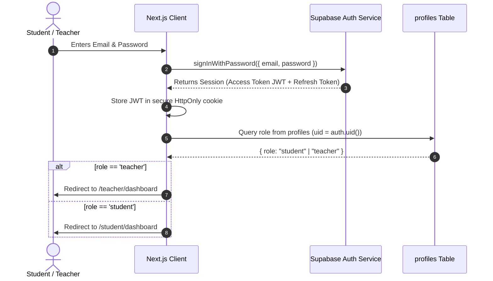
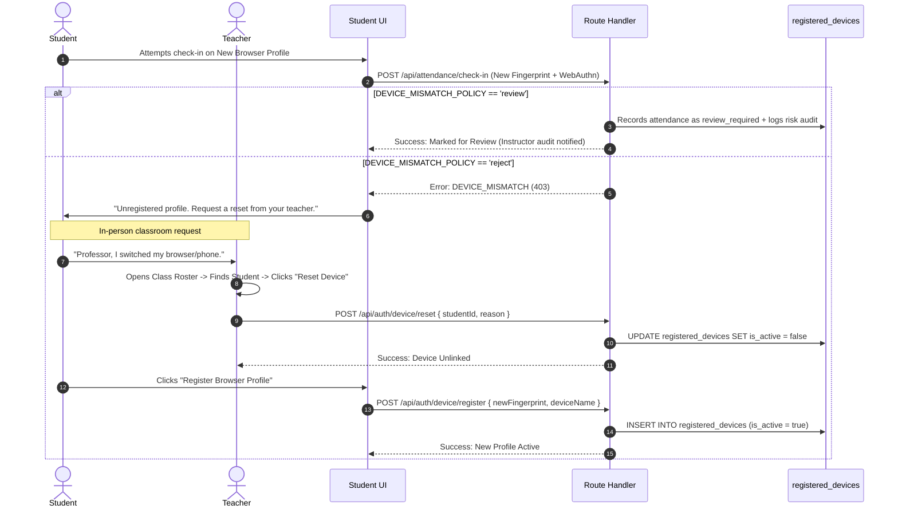

# AttendGuard Authentication & Device Identity

> **Authentication, Role-Based Access Control (RBAC) & Registered Device Policy**  
> *Clear definitions of identity, permissions, session lifecycles, and registered browser profile binding.*

---

## Table of Contents

- [Core Identity Distinctions](#core-identity-distinctions)
- [Authentication Architecture (Supabase Auth & WebAuthn)](#authentication-architecture-supabase-auth--webauthn)
- [Role-Based Access Control (RBAC)](#role-based-access-control-rbac)
- [Session Management & Expiration](#session-management--expiration)
- [The Registered Device System](#the-registered-device-system)
  - [Why Device Registration?](#why-device-registration)
  - [Single Active Device Policy & Risk Semantics](#single-active-device-policy--risk-semantics)
  - [Browser Profile Fingerprinting Mechanics](#browser-profile-fingerprinting-mechanics)
  - [WebAuthn Passkeys vs. Physical Device Binding](#webauthn-passkeys-vs-physical-device-binding)
  - [Device Replacement & Reset Flow](#device-replacement--reset-flow)
  - [Honest Security Limitations](#honest-security-limitations)
- [Unauthorized Access & Attack Mitigations](#unauthorized-access--attack-mitigations)

---

## Core Identity Distinctions

To ensure clean engineering boundaries across frontend and backend implementations, AttendGuard strictly delineates three concepts:

```text
┌────────────────────────────────────────────────────────────────────────┐
│ 1. AUTHENTICATION ("Who are you?")                                    │
│    Verified via Supabase Auth email/password credentials and           │
│    cryptographic WebAuthn/FIDO2 passkey assertion verification.        │
│    Produces an authentic JWT tied to a unique UUID.                    │
├────────────────────────────────────────────────────────────────────────┤
│ 2. AUTHORIZATION ("What are you allowed to do?")                       │
│    Verified via the user's role in the `profiles` table.               │
│    Determines whether the user accesses /student or /teacher routes.  │
├────────────────────────────────────────────────────────────────────────┤
│ 3. DEVICE REGISTRATION ("Which registered browser profile is used?")   │
│    Verified via client browser profile fingerprint matching           │
│    `registered_devices`. Acts as a supplementary risk signal.          │
└────────────────────────────────────────────────────────────────────────┘
```

---

## Authentication Architecture (Supabase Auth)

AttendGuard uses **Supabase Auth** with email and password credentials for institutional users.



### Roles Supported
- **`teacher`**: Granted access to `/teacher/*` routes, session creation, dynamic QR rotation, and report export.
- **`student`**: Granted access to `/student/*` routes, mobile QR scanner, history, and AI Advisor.

---

## Role-Based Access Control (RBAC)

RBAC is enforced at two distinct boundaries:

### 1. Edge Middleware (`src/middleware.ts`)
Next.js middleware inspects incoming requests and validates the user's role before serving pages:
- If an unauthenticated user accesses `/student/*` or `/teacher/*`, they are redirected to `/login`.
- If a user with `role: 'student'` attempts to load `/teacher/*`, they receive a `403 Forbidden` redirect.
- If a user with `role: 'teacher'` attempts to submit `/api/attendance/check-in`, the route handler rejects with `403 FORBIDDEN`.

### 2. Route Handler Guards (`src/lib/auth/guards.ts`)
Every API route validates the session server-side:
```typescript
export async function requireRole(req: NextRequest, allowedRole: 'teacher' | 'student') {
  const supabase = createServerClient(...);
  const { data: { user } } = await supabase.auth.getUser();

  if (!user) {
    throw new AuthError('UNAUTHORIZED', 401, 'Authentication required');
  }

  const { data: profile } = await supabase
    .from('profiles')
    .select('role')
    .eq('id', user.id)
    .single();

  if (profile?.role !== allowedRole) {
    throw new AuthError('FORBIDDEN', 403, `Access denied for role: ${profile?.role}`);
  }

  return { user, profile };
}
```

---

## Session Management & Expiration

1. **Access Tokens**: Short-lived JWTs (typically 1 hour) stored in secure, `SameSite=Lax`, `HttpOnly` cookies.
2. **Refresh Tokens**: Stored securely to automatically rotate expired access tokens during active browsing.
3. **Logout**: Calling `supabase.auth.signOut()` invalidates the session, purges cookies, and redirects the user to `/login`.
4. **Session Expiration during Class**: If a token expires while a teacher is projecting a QR code, the teacher display gracefully attempts a background token refresh. If refresh fails, projection freezes with a re-login prompt to prevent unauthorized challenge issuance.

---

## The Registered Device System

### Why Device Registration?
Simple email/password login is vulnerable to **credential sharing**: absent students share their login credentials with an attending friend, who logs in via a second browser tab or spare phone and scans the QR code.

To counter this, AttendGuard implements **Single Registered Device Enforcement**.

### Single Active Device Policy & Risk Semantics
- Each student account can have **exactly one** active device entry in `registered_devices`.
- When an enrolled student attempts to submit attendance via `/api/attendance/check-in`, the backend checks whether the incoming `deviceFingerprint` matches the student's active registered profile.
- **Configurable Mismatch Policy (`DEVICE_MISMATCH_POLICY`)**:
  - `review` (default recommended): A fingerprint mismatch is treated as a **supplementary risk signal** requiring review rather than proof of fraud. Attendance is recorded with status `review_required`, a `DEVICE_MISMATCH` security verification attempt is logged for audit, and the student is not locked out simply because browser attributes updated. Mandatory cryptographic WebAuthn verification remains strictly enforced.
  - `reject`: Strictly blocks check-in with `DEVICE_MISMATCH` (HTTP 403) whenever the client-supplied fingerprint differs from the registered profile.
- WebAuthn cryptographic assertion verification (Gate 6) is mandatory in all modes and cannot be bypassed by altering, omitting, or matching a fingerprint.

### Browser Profile Fingerprinting Mechanics
During device registration and check-in, the student browser computes a heuristic profile hash derived from standard, accessible web platform attributes:
- User Agent string (`navigator.userAgent`)
- Language setting (`navigator.language`)
- Screen resolution dimensions (`screen.width x screen.height`)
- Color depth (`screen.colorDepth`)
- Timezone offset (`new Date().getTimezoneOffset()`)

The client serializes these values into a delimited string and computes a SHA-256 digest:

```text
rawString = [userAgent, language, width + "x" + height, colorDepth, timezoneOffset].join("|")
deviceFingerprint = SHA-256(rawString)
```

> [!NOTE]
> **Heuristic Characteristics & Limitations**:
> The fingerprint is derived strictly from the browser attributes listed above. The implementation does **not** query Canvas, WebGL, AudioContext, `hardwareConcurrency`, `deviceMemory`, or persistent UUIDs. This fingerprint is a heuristic signal: it can collide between identical devices running the same OS and browser, change when browser settings, display scaling, or timezones change, and can be spoofed in HTTP requests. Client-supplied fingerprints are never treated as strong cryptographic authentication.

### WebAuthn Passkeys vs. Physical Device Binding
AttendGuard uses **WebAuthn (FIDO2 passkeys)** as its primary cryptographic authentication mechanism for attendance check-ins:
- WebAuthn provides unforgeable cryptographic proof that the client possesses the registered private key corresponding to the public key stored on the server.
- The ceremony enforces `userVerification: 'required'`, ensuring the local user authenticates via device biometrics (Touch ID, Face ID, Android Biometric) or screen PIN.
- **Passkey Multi-Device Syncing**: Modern operating systems support multi-device passkeys synced via Apple iCloud Keychain, Google Password Manager, or Microsoft Credential Manager. While this provides phishing-resistant, cryptographic proof of identity and local user verification, synced passkeys can be shared across multiple devices belonging to the same cloud account. Therefore, WebAuthn validates credential control, but does not guarantee single physical hardware uniqueness.

### WebAuthn Enforcement Policy (`WEBAUTHN_ENFORCEMENT_POLICY`)
AttendGuard supports two enforcement policy modes:
- **`required` (Default & Required for Production)**: Passkey enrollment and server-verified assertion are strictly mandatory for all attendance check-ins. Unregistered students cannot check in and are blocked with `403 WEBAUTHN_REQUIRED` until enrolling a passkey in Security Settings or completing an authorized administrative recovery. In production (`NODE_ENV === 'production'`), the system fails secure to `required` if the environment variable is missing, empty, or unrecognized.
- **`optional` (Development / Non-enforced Mode)**: Students with enrolled WebAuthn credentials must still provide valid WebAuthn assertions (enrolled credentials can never bypass verification). Unregistered students may check in via the documented registered-device fallback, and the backend explicitly records `webauthnVerified: false` with `webauthnStatus: 'unregistered_fallback'`, ensuring the application never falsely claims WebAuthn was verified.

### Device Replacement & Reset Flow

When a student upgrades their phone or changes browser profiles:



### Honest Security Limitations

> [!WARNING]
> **No Physical Hardware Identity**:
> AttendGuard does NOT establish guaranteed physical-device identity or hardware binding:
> 1. **Browser Fingerprint Heuristics**: The SHA-256 browser profile hash is derived from five common browser attributes. It is not cryptographic proof of hardware, has no hardware-backed attestation, and can collide or be spoofed in API requests.
> 2. **Synced Passkeys**: WebAuthn passkeys verify possession of a registered cryptographic credential with local user verification, but multi-device passkeys synchronized across cloud accounts can exist on multiple physical devices.
> 3. **Device Status Protection**: To prevent fingerprint harvesting and credential targeting, the device status endpoint (`/api/auth/device/status`) protects the stored fingerprint and never exposes it to client responses.
>
> AttendGuard treats browser profile registration as a **supplementary device-risk signal and deterrence layer** that complements rotating dynamic QR challenges, mandatory WebAuthn passkey assertions, and random in-class re-verifications.

---

## Unauthorized Access & Attack Mitigations

| Threat | System Defense | Outcome |
| :--- | :--- | :--- |
| **Student accesses Teacher routes** | Middleware role check + API `requireRole('teacher')` | Request blocked with `403 Forbidden`. |
| **Friend attempts proxy check-in on absent student's account** | Mandatory WebAuthn assertion + browser profile check | Blocked by missing/invalid WebAuthn passkey assertion. Profile mismatch logged or flagged for review. |
| **Attacker modifies or omits device fingerprint** | Mandatory WebAuthn cryptographic assertion verification | Check-in rejected without valid signed WebAuthn challenge. |
| **Student attempts to register multiple active devices** | PostgreSQL partial unique index on `(student_id) WHERE is_active = true` | Database rejects with constraint violation (`409 Conflict`). |
| **Student alters client clock to bypass token expiry** | Server evaluates token freshness exclusively using `NOW()` from PostgreSQL | Clock manipulation has zero effect. |
